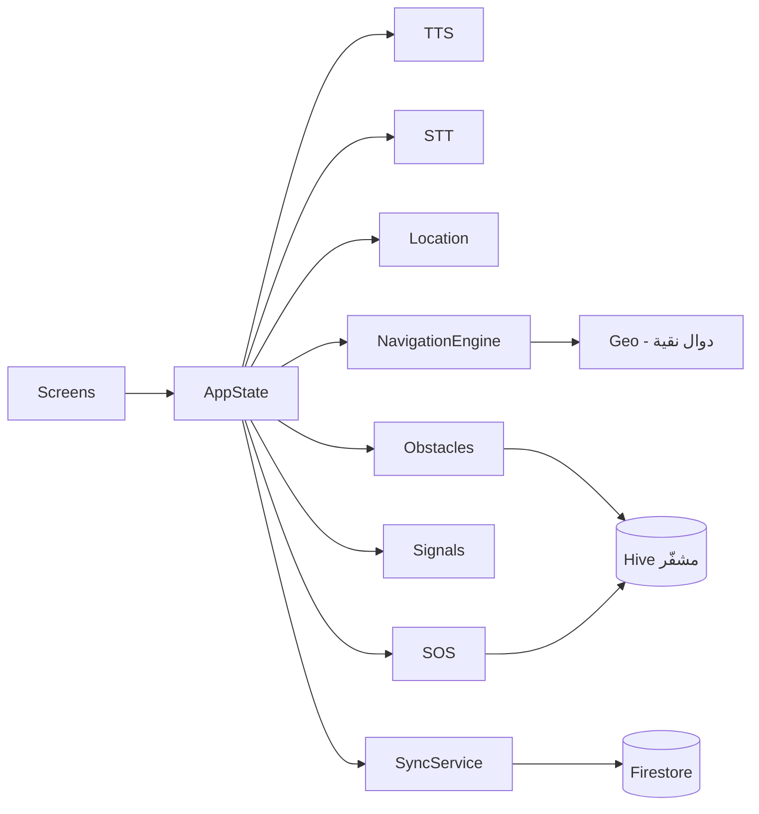

<div align="center">


# بصيرة · Basira

**طريقك الآمن.. بصوتك**

تطبيق تنقّل صوتي بالكامل، يمكّن المكفوفين وضعاف البصر من المشي في الشارع وداخل الجامعة
باستقلالية وأمان — بدون إنترنت، وبدون أن يلمس الشاشة.

[](https://flutter.dev)
[](https://dart.dev)
[]()
[]()
[](LICENSE)

</div>

---

## المحتويات

- [الفكرة في سطر](#الفكرة-في-سطر)
- [المشكلة](#المشكلة)
- [الحل](#الحل)
- [الميزات](#الميزات)
- [لماذا بصيرة؟](#لماذا-بصيرة)
- [لقطات الشاشة](#لقطات-الشاشة)
- [التقنيات](#التقنيات)
- [المعمارية](#المعمارية)
- [التشغيل](#التشغيل)
- [الاختبارات](#الاختبارات)
- [الإتاحة](#الإتاحة)
- [الخصوصية والسلامة](#الخصوصية-والسلامة)
- [خريطة الطريق](#خريطة-الطريق)
- [المساهمة](#المساهمة)
- [الترخيص](#الترخيص)

---

## الفكرة في سطر

> **عصا بيضاء رقمية**: تطبيق يسمعك، يرشدك خطوة بخطوة، يحذّرك من الإشارات والعوائق،
> ويطلب المساعدة عنك — ويعمل بالكامل بدون إنترنت.

## المشكلة

المكفوف في مصر يواجه ثلاث فجوات عند التنقل:

| الفجوة | الأثر اليومي |
|---|---|
| **غياب الإرشاد الصوتي في الشارع** | يعتمد على سؤال المارة أو مرافق دائم |
| **مسارات غير آمنة وغير موثّقة** | مخاطر أرصفة مكسورة، حفر، وأعمال بناء |
| **إشارات مرور بلا منبّه صوتي** | عبور يعتمد على التخمين أو مساعدة الآخرين |

داخل الجامعة تتضاعف المشكلة: مبانٍ متشابهة، ممرات متقاطعة، ولا خريطة يمكن «سماعها».

**النتيجة:** فقدان الاستقلالية، وتقليل الحضور، وقلق مستمر للطالب وأسرته.

## الحل

اثنتا عشرة شاشة، كلها مصمّمة لتُستخدم **بالسمع فقط**:

```
Splash → إخلاء المسؤولية → تدريب صوتي → الرئيسية
                                          ├── التنقل والإرشاد
                                          ├── الإبلاغ عن عائق
                                          ├── خريطة الجامعة
                                          └── الإعدادات + طوارئ SOS
```

## الميزات

| الميزة | الوصف |
|---|---|
| 🧭 **إرشاد صوتي لحظي** | «امشِ ٤٠ مترًا ثم انعطف يمينًا» — يُنطق تلقائيًا مع كل تغيّر في المسافة أو الاتجاه، وكشف الخروج عن المسار |
| 🗺️ **مسارات آمنة** | مسارات موثّقة بدرجة أمان، محفوظة على الجهاز وتعمل بدون إنترنت |
| 🚦 **تنبيه إشارات المرور** | حالة الإشارة والثواني المتبقية، وتحذير خاص إن كانت بلا منبّه صوتي |
| 📢 **بلاغات مجتمعية** | بلاغ عن عائق بوصف صوتي، يُحفظ محليًا ويُرفع تلقائيًا عند عودة الشبكة |
| 🏛️ **خرائط جامعات صوتية** | خريطة متجهية للحرم + دليل صوتي لكل مبنى + إرشاد من موقعك إليه |
| 🆘 **زر SOS** | عدّ تنازلي قابل للإلغاء، ثم رسالة SMS بموقعك + اتصال بجهة اتصال طارئة |
| 📴 **أوفلاين كامل** | Hive مشفّر، خرائط متجهية، وطابور مزامنة — لا يحتاج شبكة للعمل |
| ♿ **إتاحة عميقة** | TalkBack/VoiceOver، تسميات Semantics لكل عنصر، تباين عالٍ، أهداف لمس 88dp |
| 🔒 **خصوصية بالتصميم** | تشفير AES-256، لا تتبع في الخلفية، حذف كامل للبيانات من داخل التطبيق |
| 🎛️ **تحكم كامل في الصوت** | سرعة · نبرة · مستوى الصوت · اختيار الصوت العربي من أصوات الجهاز |
| 📍 **«أين أنا؟»** | شاشة كاملة تصف موقعك وأقرب مبنى وإشارة والعوائق القريبة، وتشارك موقعك برسالة |
| 📳 **اهتزاز دلالي** | 10 أنماط: يمين ≠ يسار ≠ خطر ≠ إشارة خضراء ≠ وصول — بلا حاجة للنظر أو السماع |

## تشغيل مباشر

<div align="center">

### 🌐 [جرّب بصيرة الآن على المتصفح](https://mo3bdo23.github.io/basira/)

</div>

| المنصة | الحالة | التوزيع |
|---|---|---|
| **الويب (PWA)** | ✅ جاهز ويعمل الآن | [mo3bdo23.github.io/basira](https://mo3bdo23.github.io/basira/) |
| **Android** | ✅ جاهز للبناء | `flutter build apk --release` |
| **iOS** | ✅ جاهز للبناء | `flutter build ios` (يحتاج macOS + Xcode) |
| **سطح المكتب** | ⏳ مخطط | يتطلب Visual Studio / Developer Mode على ويندوز |

> نسخة الويب تعمل على أي جهاز بمتصفح حديث — هاتف، تابلت، أو حاسوب — وتدعم قارئ الشاشة عبر النظام.

## لماذا بصيرة؟

| | خرائط عامة | تطبيقات ملاحة صوتية أجنبية | **بصيرة** |
|---|---|---|---|
| إرشاد عربي مصري | جزئي | ✗ | ✅ |
| تنبيه إشارات المرور | ✗ | ✗ | ✅ |
| بلاغات عوائق مجتمعية | ✗ | ✗ | ✅ |
| خرائط داخل الحرم الجامعي | ✗ | ✗ | ✅ |
| يعمل بدون إنترنت | ✗ | جزئي | ✅ |
| SOS برسالة موقع | ✗ | ✗ | ✅ |
| مجاني ومفتوح المصدر | ✗ | ✗ | ✅ |

## لقطات الشاشة

> تُضاف الصور في `docs/screenshots/` — الرئيسية · التنقل · البلاغ · خريطة الجامعة · SOS.
> للتجربة الفورية: [نسخة الويب](https://mo3bdo23.github.io/basira/) تعمل الآن.

## التقنيات

| الطبقة | التقنية |
|---|---|
| الواجهة | Flutter 3.27+ / Material 3 / RTL |
| الصوت | `flutter_tts` (ar-EG) · `speech_to_text` |
| الموقع | `geolocator` + محرك إرشاد مخصص |
| الخرائط | رسم متجهي بـ `CustomPainter` (أوفلاين) + `flutter_map`/OSM اختياري |
| التخزين | `hive` مشفّر AES-256 + `flutter_secure_storage` |
| السحابة | Firebase (Auth / Firestore / FCM) — **اختياري** |
| الحالة | `provider` + `ChangeNotifier` |

## المعمارية



**مبادئ التصميم**

1. **الصوت أولًا** — كل شاشة تُعلن نفسها، وكل إجراء له تأكيد منطوق.
2. **أوفلاين أولًا** — Hive مصدر الحقيقة، والسحابة مزامنة اختيارية.
3. **قابلية الاختبار** — الجغرافيا والإرشاد والأوامر الصوتية دوال نقية مغطاة باختبارات.

التفاصيل: [docs/ARCHITECTURE.md](docs/ARCHITECTURE.md)

## التشغيل

### المتطلبات

- Flutter **3.27+** (Dart 3.6+)
- Android SDK 34+ أو Xcode 15+ (لـ iOS)

```bash
git clone https://github.com/mo3bdo23/basira.git
cd basira

flutter pub get
flutter run                  # تشغيل على جهاز/محاكي/متصفح

flutter build apk --release  # أندرويد
flutter build web --release  # ويب (PWA)
flutter build ios            # iOS (على macOS)
```

### Firebase (اختياري)

التطبيق يعمل كاملًا بدونه. للتزامن السحابي:

```bash
dart pub global activate flutterfire_cli
flutterfire configure
```

ثم ضع `android/app/google-services.json` وفعّل إضافة Google Services في Gradle.
انشر قواعد الأمان من [`firebase/firestore.rules`](firebase/firestore.rules).

## الاختبارات

```bash
flutter test
```

| الملف | التغطية |
|---|---|
| `test/geo_test.dart` | حسابات هافرساين، الاتجاهات، الدوران، صياغة المسافات |
| `test/navigation_engine_test.dart` | التقدم، الوصول، الخروج عن المسار، تكرار التنبيهات |
| `test/voice_command_test.dart` | تطبيع العربية المصرية وتصنيف 13 نية |
| `test/models_test.dart` | تسلسل البيانات، تطبيع أرقام SOS، الإعدادات |
| `test/widget_test.dart` | شاشة الرئيسية وتسميات الإتاحة |

## الإتاحة

- تسمية وتلميح لكل عنصر تفاعلي، وإعلان صوتي لاسم كل شاشة.
- لا يوجد إجراء يعتمد على الصوت وحده: لكل أمر زر مقابل.
- تباين ≥ 4.5:1، وضع «أصفر على أسود»، وأهداف لمس ≥ 88dp.

التفاصيل: [docs/ACCESSIBILITY.md](docs/ACCESSIBILITY.md)

## الخصوصية والسلامة

- الموقع يُستخدم **أثناء الاستخدام فقط** — لا تتبع خلفي.
- التخزين المحلي مشفّر، والمفتاح في Keystore/Keychain.
- الموقع لا يُشارك إلا مع جهات اتصال SOS التي يضيفها المستخدم.
- التطبيق **أداة مساعدة** لا بديلًا عن العصا البيضاء — إخلاء المسؤولية إلزامي قبل الاستخدام.

اقرأ: [سياسة الخصوصية](docs/PRIVACY.md) · [إخلاء المسؤولية](docs/DISCLAIMER.md)

## خريطة الطريق

انظر [docs/ROADMAP.md](docs/ROADMAP.md): دعم Bluetooth Beacons، توصيف الصور بالذكاء الاصطناعي،
ساعة ذكية، وتكامل مع إشارات المرور الحكومية.

## العرض التقديمي

[](docs/Basira-Presentation.pptx)

عرض من 12 شريحة بالعربية يغطي المشكلة والحل والميزات والمعمارية والأثر:
**[docs/Basira-Presentation.pptx](docs/Basira-Presentation.pptx)** — يُولَّد بـ
`python tools/build_presentation.py`.

## المساهمة

نرحّب بالمساهمات — اقرأ [CONTRIBUTING.md](CONTRIBUTING.md) قبل فتح Pull Request.

## الترخيص

[MIT](LICENSE) © 2026 Basira

---

<details>
<summary><strong>English summary</strong></summary>

**Basira** (بصيرة) is a voice-first Flutter application that helps blind and low-vision
people navigate streets and university campuses independently. It provides real-time
turn-by-turn voice guidance, safe-route maps, traffic-signal audio alerts, community
obstacle reports, spoken campus maps, a cancellable SOS that sends the user's location
by SMS, and full offline operation. The UI is Arabic-first (RTL), fully accessible with
TalkBack/VoiceOver, and stores all data encrypted on the device. Firebase sync is optional.

</details>
