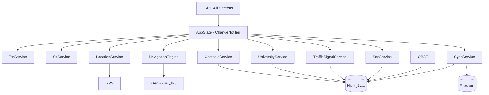
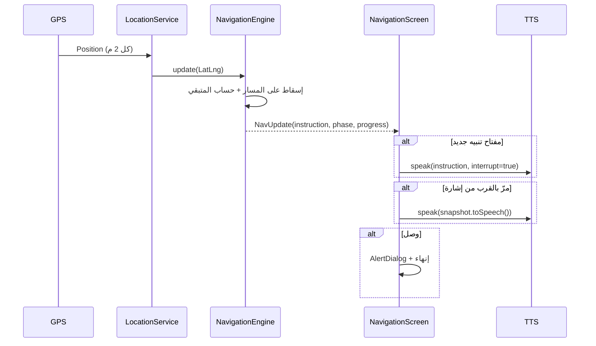

# معمارية تطبيق بصيرة

## 1. نظرة عامة



الطبقات من الأسفل للأعلى:

| الطبقة | المسؤولية | أمثلة |
|---|---|---|
| **Core** | ثوابت وثيم وحسابات لا تعرف شيئًا عن الواجهة | `geo.dart`, `theme.dart`, `app_config.dart` |
| **Models** | نماذج بيانات غير قابلة للتغيير + تسلسل | `SafeRoute`, `Obstacle` |
| **Services** | تكامل مع الأجهزة/الشبكة/التخزين | `TtsService`, `LocationService` |
| **State** | تنسيق + حالة قابلة للمراقبة | `AppState` |
| **UI** | عرض + إتاحة | `HomeScreen`, `BigActionButton` |

## 2. تدفّق التنقل (Sequence)



**لماذا محرك نقي؟** `NavigationEngine` لا يعرف GPS ولا صوتًا؛ يأخذ `LatLng` ويعيد `NavUpdate`.
هذا يجعل أهم منطق في التطبيق قابلًا للاختبار بدون جهاز (انظر `test/navigation_engine_test.dart`).

### حساب التقدم

1. إيجاد أقرب قطعة `i` على المسار عبر إسقاط عمودي (`Geo.projectionFactor`).
2. `remaining = (1 - t) * len(i) + Σ len(j>i)`.
3. `progress = 1 - remaining / total`.
4. الوصول عند `distance(end) ≤ 8 م`.
5. الخروج عن المسار عند `distanceToSegment > 25 م`.

## 3. استراتيجية الأوفلاين

| البيانات | المصدر | العمل بلا شبكة |
|---|---|---|
| الجامعات والمباني | `assets/data/universities.json` → Hive عند أول تشغيل | ✅ |
| المسارات الآمنة | `assets/data/routes.json` → Hive | ✅ |
| إشارات المرور | Hive + دورة زمنية محلية | ✅ (الحالة تقديرية) |
| البلاغات | Hive + `sync_queue` | ✅ تُرفع لاحقًا |
| خرائط الحرم | `CustomPaint` (رسم متجهي) | ✅ |
| Nطق/سماع | محرّكات النظام | ✅ |
| التزامن | Firestore | ⏳ عند توفر الشبكة |

**طابور المزامنة:** كل بلاغ يُكتب بـ `synced=false`، وعند نجاح الرفع فقط يتحول إلى `true`.
فشل الرفع لا يحذف شيئًا (at-least-once).

## 4. التخزين المشفّر

```dart
// مفتاح AES-256 يُولَّد مرة واحدة ويُحفظ في Keystore/Keychain
final key = base64Decode(await secureStorage.read(key: 'basira.hive.key.v1') ?? generate());
await Hive.openBox('obstacles', encryptionCipher: HiveAesCipher(key));
```

- كل الصناديق مشفّرة ما عدا لا شيء — بما فيها الإعدادات.
- في حال تعذّر التخزين الآمن (محاكي/اختبارات) يعمل التطبيق بلا تشفير مع تعطيل الميزة بأمان
  (لا انهيار)، وتُعرض الحالة في شاشة الخصوصية.

## 5. إدارة الحالة

- `AppState extends ChangeNotifier` عبر `provider`.
- الخدمات تُحقن اختياريًا في المُنشئ (لاختبارات مستقبلية).
- `ValueNotifier` للحالات السريعة (موقع، استماع، نطق) لتقليل إعادة بناء الشجرة.
- شاشة التنقل تستمع مباشرة إلى `location.position` بدل إعادة بناء عامة.

## 6. الإتاحة (Accessibility)

| المبدأ | التطبيق |
|---|---|
| تسمية كل عنصر | `Semantics(label:, hint:, button:)` في كل مكوّن تفاعلي |
| الإعلان عند التنقل | `SemanticsService.announce` في `AppScaffold` |
| أهداف لمس كبيرة | `AppConfig.largeTouchTargetDp = 88` |
| دعم RTL | `locale: ar_EG` + `Directionality` تلقائي |
| تباين عالٍ | ثيم أصفر/أسود مطابق لـ WCAG AA |
| قراءة عند التركيز | خيار `announceOnFocus` يقرأ العنصر عند مرور focus |
| عدم الاعتماد على الصوت فقط | كل شيء له بديل لمسي (أزرار) |

## 7. الأداء

- لا صور نقطية كبيرة: الخرائط متجهية (CustomPaint).
- `distanceFilter: 2` يقلل أحداث GPS.
- النطق يُدار بطابور وليس بـ `speak` متزامن.
- `const` widgets حيث أمكن؛ `ValueListenableBuilder` بدل `setState` العام.
- حجم APK المتوقع بعد `--split-per-abi`: **~18–22 MB** لكل معمارية.

## 8. الأمان

| التهديد | الإجراء |
|---|---|
| سرقة الجهاز وقراءة البيانات | تشفير Hive + مفتاح في Keystore |
| تسريب الموقع | لا إرسال دوري، فقط عند SOS/بلاغ بموافقة |
| اعتراض الشبكة | Firebase TLS + قواعد Firestore |
| بلاغات كاذبة | حالة `pending` → تحقق متطوع/مسؤول قبل `verified` |
| حقن في البلاغات | Firestore Rules تتحقق من الأنواع والأطوال |

## 9. قابلية التوسّع

- إضافة لغة: ملف `l10n` + خط عربي مناسب؛ البنية لا تفترض العربية في المنطق.
- إضافة مصدر ملاحة: استبدال `NavigationEngine` بواجهة `RoutingProvider`.
- إضافة Beacon: `LocationService` يقبل مزوّد موقع داخلي (BLE) دون تغيير المحرك.
